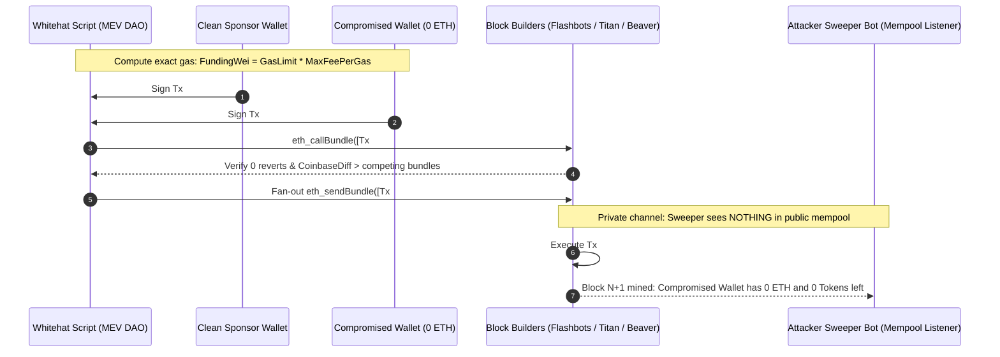

# Compromised Wallet Sweeper Rescue (Flashbots Atomic Whitehat Recovery & Airdrop Claim)

**TL;DR:** To **rescue tokens from a compromised wallet** monitored by an automated ETH sweeper bot, you must bypass the Ethereum public mempool entirely and execute an atomic multi-transaction bundle via Flashbots (`eth_sendBundle`). In a **Flashbots whitehat rescue**, a clean `sponsorWallet` sends the exact wei needed for gas in Transaction #1, and the `compromisedWallet` claims or transfers the stuck ERC-20 tokens, NFTs, staking positions, or unclaimed airdrops to a safe vault in Transaction #2 within the **exact same block** (`blockNumber + 1`). Because both transactions execute back-to-back inside the block builder's private sandbox with `0 wei` left behind at the end of the bundle, the attacker's sweeper bot never sees unspent ETH in the mempool and cannot front-run the recovery. This open-source TypeScript (`viem`) toolkit is maintained by **[MEV DAO](https://mevdao.org)** alongside our production guide on **[How to Rescue Tokens from a Compromised Wallet with a Sweeper Bot (Flashbots Guide)](https://mevdao.org/blog/how-to-rescue-tokens-from-a-compromised-wallet-with-a-sweeper-bot-flashbots-guid)**.

[](./LICENSE)
[](https://mevdao.org)
[](https://www.typescriptlang.org/)
[](https://mevdao.org/blog/how-to-rescue-tokens-from-a-compromised-wallet-with-a-sweeper-bot-flashbots-guid)

---

## Emergency Links & Whitehat Rescue Documentation

- **24/7 Managed Whitehat Rescue Desk:** **[Rescue Tokens from a Compromised Wallet — MEV DAO Sweeper Bot Rescue Service](https://mevdao.org/blog/rescue-tokens-from-a-compromised-wallet-sweeper-bot-rescue-service)**
- **Complete Technical Walkthrough:** **[How to Rescue Tokens from a Compromised Wallet with a Sweeper Bot (Flashbots Guide)](https://mevdao.org/blog/how-to-rescue-tokens-from-a-compromised-wallet-with-a-sweeper-bot-flashbots-guid)**
- **Airdrop & Vesting Recovery Guide:** **[How to Claim an Airdrop from a Compromised Wallet Before the Sweeper Does](https://mevdao.org/blog/how-to-claim-an-airdrop-from-a-compromised-wallet-before-the-sweeper-does)**
- **EIP-7702 Malicious Delegation Removal:** **[How to Check and Remove a Malicious EIP-7702 Delegation](https://mevdao.org/blog/how-to-check-and-remove-a-malicious-eip-7702-delegation)**
- **Official Portal:** **[MEV DAO (mevdao.org)](https://mevdao.org)**

---

## How Automated Sweeper Bots Work (And Why Sending Gas Normally Always Fails)

When a private key or seed phrase is leaked via a phishing site, fake Ledger update, malicious npm package, or exposed `.env` file, attackers immediately import the key into an automated **sweeper bot**.

A sweeper bot maintains persistent WebSocket connections to multiple Ethereum nodes (`newPendingTransactions` and new block headers) watching your compromised address (`0xCompromised`):

1. **Public Mempool Front-Running / Replacement:** The instant anyone broadcasts a transaction sending `0.005 ETH` to `0xCompromised` so the victim can pay gas to transfer out an ERC-20 token or unstake an LSD position, the sweeper bot sees that incoming ETH transfer in the mempool. It immediately signs a native ETH transfer from `0xCompromised` to the attacker's wallet with a higher `maxPriorityFeePerGas`, draining 99.9% of the incoming ETH in the very same block before your manual MetaMask transaction can even be signed.
2. **Block-Reactive Token Sweeping:** Advanced 2026 sweeper bots also monitor `Transfer(address,address,uint256)` events and upcoming airdrop distributor contracts. If an airdrop claim transaction hits the public mempool, the sweeper bot bundles its own `transfer()` call right behind your `claim()` call—or replaces your `claim()` nonce outright if the claim contract allows specifying a `recipient` parameter.
3. **EIP-7702 Smart Account Hijacking:** Post-Pectra sweeper bots frequently attach a malicious **EIP-7702 code delegation** (`0xef0100 || sweeperContract`) directly onto the compromised EOA. When an EOA has an active EIP-7702 delegation, any plain ETH sent to the address triggers the attacker's `receive()` fallback hook and reverts or forwards the ETH immediately! Always verify whether your wallet has an active `0xef0100` code prefix before funding a standard two-transaction bundle (see our companion repo [`eip-7702-delegation-checker-revoker`](https://github.com/mevdao-org/eip-7702-delegation-checker-revoker) and **[How to Check and Remove a Malicious EIP-7702 Delegation](https://mevdao.org/blog/how-to-check-and-remove-a-malicious-eip-7702-delegation)**).

---

## Architecture of an Atomic Flashbots Whitehat Rescue

To beat a sweeper bot, your transactions must **never touch the public mempool** and must leave **zero residual ETH** in the compromised wallet. We achieve this by packaging an ordered transaction array into an `eth_sendBundle` call sent directly to Ethereum block builders (`Flashbots`, `Titan Builder`, `Beaverbuild`, `Rsync Builder`).



### The Zero-Dust Gas Equation

Why is exact gas math critical in `src/rescue.ts`?
Suppose `Tx #2` (`ERC20.transfer`) has a `gasLimit` of `65,000` gas, and the actual execution consumes `51,400` gas. In EIP-1559:
- When a transaction begins execution, the EVM requires the sender (`compromisedWallet`) to hold at least `gasLimit * maxFeePerGas`.
- Therefore, in `Tx #1`, `sponsorWallet` must transfer:
  $$\text{ExactFundingWei} = \text{gasLimit}_{\text{tx2}} \times \text{maxFeePerGas}_{\text{tx2}}$$
- Because both transactions execute atomically inside the same block (`[Tx #1, Tx #2]`), `Tx #2` executes at the exact millisecond `Tx #1` finishes—**inside the same block before any external transaction from the sweeper bot can be interleaved**. Even if `65,000 - 51,400 = 13,600` gas is refunded at the end of `Tx #2`, your ERC-20 tokens have already arrived in `SAFE_RECIPIENT_ADDRESS`!

For multi-step rescues (`src/airdropRescue.ts`), where `Tx #2` claims an airdrop and `Tx #3` transfers the claimed tokens to `SAFE_RECIPIENT_ADDRESS`:
$$\text{ExactFundingWei} = (\text{gasLimit}_{\text{claim}} + \text{gasLimit}_{\text{transfer}}) \times \text{maxFeePerGas}$$

---

## Comparison: Sweeper Rescue Scenarios & Required Bundle Structure

Not every compromised wallet holds a simple transferable ERC-20 token. Depending on how the asset is locked and how aggressive the sweeper is, choose the corresponding bundle pattern from the table below (and read **[Rescue Tokens from a Compromised Wallet — Sweeper Bot Rescue Service](https://mevdao.org/blog/rescue-tokens-from-a-compromised-wallet-sweeper-bot-rescue-service)** for complex staking cool-downs):

| Asset / Compromise Type | Can Standard `eth_sendBundle` Rescue It? | Bundle Transaction Sequence | Key Technical Pitfall |
| :--- | :--- | :--- | :--- |
| **Transferable ERC-20 / ERC-721 / ERC-1155** | **Yes (`npm run rescue:erc20`)** | `[Tx1: Sponsor Fund ETH, Tx2: Token.transfer(SafeVault)]` | Must fan out to Titan + Beaverbuild + Rsync + Flashbots simultaneously. |
| **Unclaimed Merkle Airdrop** | **Yes (`npm run rescue:airdrop`)** | `[Tx1: Sponsor Fund ETH, Tx2: Distributor.claim(), Tx3: Token.transfer(SafeVault)]` | Sweeper also monitors the claim launch block; requires Block-0 coinbase bribe. |
| **Vesting / Unstaking Unlocking at Block $T$** | **Yes (Block-$T$ Bundle)** | `[Tx1: Sponsor Fund, Tx2: Vault.withdraw(), Tx3: Token.transfer(SafeVault)]` | Must pre-simulate with state overrides (`block.timestamp >= unlockTime`). |
| **EIP-7702 Delegated Sweeper (`0xef0100...`)** | **Requires Type-4 Revocation** | `[Tx1: Type-4 Sponsored Revocation to 0x00..00 + Rescue]` | Sending plain ETH in `Tx1` reverts or auto-forwards via the malicious `receive()` hook! |
| **L2 Chains Without Flashbots (`Arbitrum`, `Base`)** | **Requires Sequencer Ordering / EIP-7702** | Atomic EIP-7702 delegation + sponsored `execute()` in 1 tx | L2 FIFO sequencers do not support `eth_sendBundle`; use atomic Type-4 batching. |

---

## Step-by-Step Usage Guide

### Prerequisites
- **Node.js** `>= 20.x`
- A **Clean Sponsor Wallet** (`SPONSOR_PRIVATE_KEY`) funded with `0.01–0.05 ETH` on Ethereum Mainnet. **Never** reuse a wallet that has interacted with the compromised environment.
- A **Clean Safe Destination Address** (`SAFE_RECIPIENT_ADDRESS`), ideally a fresh hardware wallet.
- The **Compromised Private Key** (`COMPROMISED_PRIVATE_KEY`), exported onto an isolated, malware-free machine.

### 1. Clone & Install

```bash
git clone https://github.com/mevdao-org/compromised-wallet-sweeper-rescue.git
cd compromised-wallet-sweeper-rescue
npm install
cp .env.example .env
```

### 2. Configure `.env` for ERC-20 Token Rescue

Edit `.env` with your RPC URL, clean sponsor private key, compromised private key, safe recipient address, and the contract address of the stuck ERC-20 token:

```ini
ETH_HTTP_RPC_URL=https://eth-mainnet.g.alchemy.com/v2/YOUR_KEY
SPONSOR_PRIVATE_KEY=0x...
COMPROMISED_PRIVATE_KEY=0x...
SAFE_RECIPIENT_ADDRESS=0xYourCleanHardwareWallet
TOKEN_CONTRACT_ADDRESS=0xA0b86991c6218b36c1d19D4a2e9Eb0cE3606eB48
PRIORITY_FEE_GWEI=15
```

### 3. Execute the Atomic ERC-20 Rescue (`src/rescue.ts`)

```bash
npm run typecheck
npm run rescue:erc20
```

What `src/rescue.ts` does automatically:
1. Queries the live ERC-20 balance, token decimals, and current nonces of both `sponsorWallet` and `compromisedWallet`.
2. Estimates the exact gas required for `ERC20.transfer(safeRecipient, fullBalance)` and calculates `exactEthFundingRequired = estimatedTransferGas * maxFeePerGas`.
3. Signs `Tx #1` (Sponsor -> Compromised ETH transfer) and `Tx #2` (Compromised -> SafeVault ERC-20 transfer) offline.
4. Runs a pre-flight `eth_callBundle` simulation against `https://relay.flashbots.net` to verify that neither transaction reverts.
5. Broadcasts the signed bundle simultaneously to **Flashbots**, **Beaverbuild**, **Titan Builder**, and **Rsync Builder** across the next 3 consecutive blocks (`blockNumber + 1`, `blockNumber + 2`, `blockNumber + 3`).

---

## Rescuing Unclaimed Airdrops Before the Sweeper Bot Does (`src/airdropRescue.ts`)

As detailed in our guide **[How to Claim an Airdrop from a Compromised Wallet Before the Sweeper Does](https://mevdao.org/blog/how-to-claim-an-airdrop-from-a-compromised-wallet-before-the-sweeper-does)**, claiming an airdrop from a compromised wallet is one of the highest-stakes whitehat operations in DeFi because the attacker often knows the exact token generation event (TGE) block and runs their own competing Flashbots bundle!

### 3 Rules to Beat an Attacker's Competing Airdrop Bundle:
1. **Check Whether `claim()` Supports a Custom `recipient` Address:** Always inspect the Airdrop Distributor contract source code on Etherscan first. Many Merkle distributor contracts implement `claim(uint256 index, address account, uint256 amount, bytes32[] calldata merkleProof)` where tokens are minted to `account`, **or** `claimOnBehalf(address beneficiary, address recipient, ...)`. If any address can call `claim()` or if `recipient` is customizable, you may not even need to transfer from the compromised wallet in a separate transaction.
2. **Use a 3-Transaction Atomic Bundle (`[SponsorFund, Claim, Transfer]`):** When `claim()` requires `msg.sender == compromisedWallet` and sends tokens directly to `msg.sender`, use `buildAtomicAirdropRescueBundle()` in `src/airdropRescue.ts` to chain `nonce` (the claim) and `nonce + 1` (the ERC-20 transfer) inside the same bundle.
3. **Outbid the Attacker's Coinbase Bribe in Block 0:** If an airdrop opens at a specific `claimStartBlock` or `claimStartTimestamp`, both you and the attacker will submit bundles targeting that exact block. Block builders (`Titan`, `Beaverbuild`) will include whichever bundle pays the highest **Effective Bundle Gas Price**. Increase `PRIORITY_FEE_GWEI` (or append a `Tx #4` from `sponsorWallet` paying `block.coinbase`) so the builder selects your whitehat bundle over the attacker's bundle, rendering the attacker's conflicting nonce invalid.

---

## Pre-Flight Troubleshooting Checklist

If your `eth_callBundle` simulation passes locally but your bundle isn't landing on-chain, check these five failure modes immediately:

1. **Active EIP-7702 Delegation on `compromisedWallet`:** Run `eth_getCode` on your compromised address. If the returned bytecode begins with `0xef0100`, the attacker has installed an EIP-7702 smart account sweeper! Sending ETH to `compromisedWallet` in `Tx #1` will execute the attacker's fallback function and fail or divert funds. Use our **[EIP-7702 Delegation Checker & Revoker](https://github.com/mevdao-org/eip-7702-delegation-checker-revoker)** first.
2. **Sweeper Bot Incrementing Nonce via Cancels:** If a sweeper bot detects activity (because you accidentally sent a transaction to a public RPC instead of Flashbots), it may broadcast a `0 ETH` self-transfer to increment `compromisedNonce`, invalidating your signed bundle. Never query or broadcast signed transactions through untrusted public RPCs.
3. **Token Transfer Paused or Blacklisted:** Verify on Etherscan whether the ERC-20 token has `paused() == true`, a transfer cooldown after staking, or requires claiming via a proxy contract.
4. **Priority Fee Too Low During Mainnet Gas Spikes:** Ensure `PRIORITY_FEE_GWEI` is at least `10–25 gwei` (or higher during contested airdrop claims) so builders prioritize your 2-tx or 3-tx bundle at the top of the block.

---

## Frequently Asked Questions (FAQ)

### 1. Why can't I just send $5 of ETH to my compromised wallet and quickly transfer my tokens out in MetaMask?
Automated sweeper bots monitor the Ethereum mempool via low-latency WebSocket feeds and detect incoming ETH transfers within 10–30 milliseconds—long before the block is even mined. The sweeper bot immediately signs a replacement transaction draining that ETH in the exact same block it arrives, leaving you with `$0` for gas. You must use an atomic Flashbots bundle (`[SponsorFund, TokenTransfer]`) so both transactions execute privately inside the block builder without ever entering the public mempool.

### 2. Does a Flashbots rescue bundle cost money if it doesn't land in the next block?
No. Flashbots bundles (`eth_sendBundle`) only cost gas if the block builder successfully includes the entire bundle on-chain without any transaction reverting. If a builder does not win the slot for `blockNumber + 1`, or if a simulation reverts, you pay `$0.00`.

### 3. What if the sweeper bot is also using Flashbots to steal my upcoming airdrop?
When two competing Flashbots bundles contain transactions from the same `compromisedWallet` at the same `nonce`, they are mutually exclusive—a block builder can only include one of them. Builders rank conflicting bundles strictly by **total builder profit per gas unit** (`Effective Bundle Gas Price`). By bidding a higher priority fee or explicit `block.coinbase` tip from your `sponsorWallet` and fanning out to Titan, Beaverbuild, Rsync, and Flashbots simultaneously, your whitehat bundle wins inclusion and permanently invalidates the attacker's transaction. Read **[How to Claim an Airdrop from a Compromised Wallet Before the Sweeper Does](https://mevdao.org/blog/how-to-claim-an-airdrop-from-a-compromised-wallet-before-the-sweeper-does)** for the complete playbook.

### 4. How do I rescue tokens if my compromised wallet was infected with an EIP-7702 sweeper delegation?
Under EIP-7702 (live on Ethereum since the Pectra upgrade), an attacker with your private key can sign a Type-4 (`0x04`) authorization that delegates your EOA's code to a malicious sweeper contract (`0xef0100 || sweeperAddress`). If you try a standard 2-tx rescue where `Tx #1` sends ETH to the compromised EOA, the malicious `receive()` hook steals the ETH immediately! Instead, you must use a **sponsored Type-4 transaction** where `sponsorWallet` pays the gas natively and includes a new `authorizationList` item signed by `compromisedWallet` that revokes the delegation (setting it to `0x0000000000000000000000000000000000000000` or a whitehat rescue implementation) in a single atomic transaction. See **[How to Check and Remove a Malicious EIP-7702 Delegation](https://mevdao.org/blog/how-to-check-and-remove-a-malicious-eip-7702-delegation)**.

### 5. Can I rescue staked tokens (e.g., Lido withdrawals, Pendle positions, or EigenLayer cooldowns) with a 7-day unbonding period?
Yes, via a two-phase Flashbots bundle strategy. In **Phase 1**, you send a 2-tx bundle (`[SponsorFund, StakingContract.requestWithdrawal()]`) to start the cooldown timer without exposing ETH to the sweeper. In **Phase 2**, as soon as the unbonding block/timestamp arrives, you run a high-bribe Block-0 bundle (`[SponsorFund, StakingContract.claimWithdrawal(), Token.transfer(SafeVault)]`) at the exact unlock second. For high-value positions where an attacker is actively watching the unlock timer, contact the **[MEV DAO Whitehat Rescue Service](https://mevdao.org/blog/rescue-tokens-from-a-compromised-wallet-sweeper-bot-rescue-service)**.

### 6. How do I rescue tokens on Arbitrum, Base, Optimism, or Polygon where `relay.flashbots.net` does not exist?
Layer-2 rollups use centralized First-In-First-Out (FIFO) sequencers rather than Ethereum's PBS builder auction, so `eth_sendBundle` is not natively supported on most L2s. On chains that support **EIP-7702**, the cleanest L2 rescue method is an atomic Type-4 transaction paid entirely by `sponsorWallet` (`0 ETH` ever enters the compromised wallet). On chains without EIP-7702, rescues require sub-millisecond co-located sequencer submission pairs (`sendRawTransaction` back-to-back over warm TCP sockets).

### 7. Is it safe to run this script on the same computer where my wallet was compromised?
**Never** run a rescue script or generate your `SPONSOR_PRIVATE_KEY` / `SAFE_RECIPIENT_ADDRESS` on the machine that was compromised until you have verified the vector of compromise. If your machine has clipboard malware or an active info-stealer, typing your new `SPONSOR_PRIVATE_KEY` into that machine will compromise your sponsor wallet as well. Always execute from a clean machine or isolated Linux environment.

---

## Further Reading & Whitehat Support

- **[MEV DAO Official Portal (mevdao.org)](https://mevdao.org)**
- **[How to Rescue Tokens from a Compromised Wallet with a Sweeper Bot (Flashbots Guide)](https://mevdao.org/blog/how-to-rescue-tokens-from-a-compromised-wallet-with-a-sweeper-bot-flashbots-guid)**
- **[Rescue Tokens from a Compromised Wallet: MEV DAO Sweeper Bot Rescue Service](https://mevdao.org/blog/rescue-tokens-from-a-compromised-wallet-sweeper-bot-rescue-service)**
- **[How to Claim an Airdrop from a Compromised Wallet Before the Sweeper Does](https://mevdao.org/blog/how-to-claim-an-airdrop-from-a-compromised-wallet-before-the-sweeper-does)**
- **[How to Check and Remove a Malicious EIP-7702 Delegation](https://mevdao.org/blog/how-to-check-and-remove-a-malicious-eip-7702-delegation)**

## License

Released under the [MIT License](./LICENSE) by **MEV DAO** (`research@mevdao.org`).
